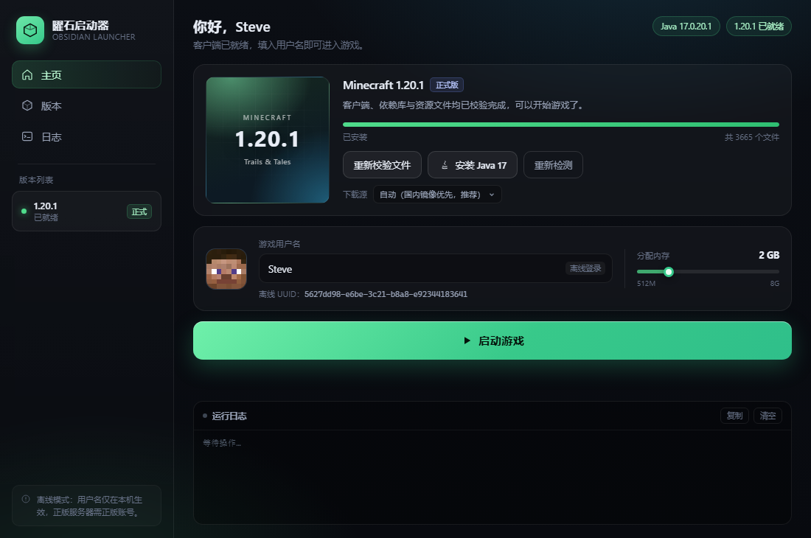
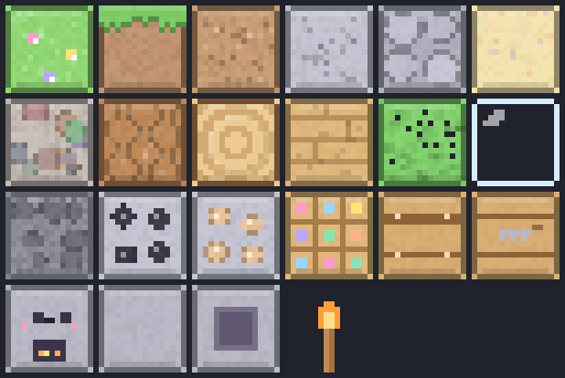

# 曜石启动器 · Obsidian Launcher

一个轻量的 Minecraft 启动器（参考 PCL 的思路自行实现），当前支持 **Minecraft 1.20.1**。
无需预先安装 Java、无需手动下载游戏文件：填个用户名就能玩。

  

仓库地址：<https://github.com/back-boundary/Black-stone-launch>

## 界面




## 功能

- **用户名登录（离线模式）**：输入 3–16 位英文/数字/下划线，自动生成与 Java 端 `OfflinePlayer:<name>` 一致的离线 UUID
- **一键启动 Minecraft 1.20.1（辅助模式）**：自动下载客户端、全部依赖库、natives、资源文件
- **辅助模式**：1.20.1 已内置 Fabric Loader + 自研辅助模组（见下文「辅助模组」）
- **自动准备 Java**：本机没有 Java 17 时，自动从镜像下载 Temurin JRE 17 并解压到 `runtime/jre17`，不污染系统环境
- **多下载源**：国内镜像（BMCLAPI / 清华 TUNA）优先，失败自动回退官方源，可手动切换
- **可视进度**：百分比、实时速度、已下载/总大小、逐行运行日志
- **内存分配**：512 MB ~ 8 GB 可调
- **断点续传式重复校验**：已存在的文件自动跳过，装坏了再点一次「重新校验文件」即可

## 辅助模组（obsidianassist）

1.20.1 已改造为 Fabric 辅助模式（KnotClient 启动），内置自研客户端模组：

- **按键显示 HUD**：屏幕左下角实时显示 WASD 与鼠标左/右键按压状态（按下变绿），按 **F6** 可开关
- **动态披风**：所有玩家（含第三人称）背部渲染程序化动画披风（流动波纹 + 菱形闪光），按 **F7** 循环切换 6 款配色：曜石紫 / 樱花粉 / 极光绿 / 熔岩橙 / 冰霜蓝 / 彩虹（色相流动），选择持久化到 `.minecraft/config/obsidianassist.json`
- **Q 版材质包**：`ObsidianQ-1.20.1.zip` 已放入 `resourcepacks/` 并默认启用 —— 22 张代码手绘方块纹理（圆润描边 + 马卡龙配色，熔炉自带可爱表情），GUI（按钮/血量/背景）做了柔和调色且不破坏布局；预览图见 `docs/pack-preview.png`

相关源码在独立工程 `../mc-assist-mod/`（Fabric 1.20.1，yarn 映射，Gradle 构建）：

```
mc-assist-mod/
├── build.gradle / settings.gradle / gradle.properties
├── tools/merge-fabric.js   把 Fabric Loader 合并进 1.20.1 版本 JSON（可重复执行，先备份 .bak）
└── src/main/java/com/obsidian/assist/
    ├── AssistMod.java                    入口：惰性注册动态披风纹理（必须等 GL 上下文就绪）
    ├── KeyHud.java                       按键 HUD（GLFW 轮询 + DrawContext 绘制，F6 切换）
    └── mixin/
        ├── InGameHudMixin.java           HUD 渲染钩子（驱动披风动画 + 绘制按键）
        └── AbstractClientPlayerEntityMixin.java  覆写 getCapeTexture / canRenderCapeTexture
```

重新构建：`gradle build`（需 JDK 17），产物拷贝到 `.minecraft/mods/` 即生效。
若要回到原版：把 `.minecraft/versions/1.20.1/1.20.1.json.bak` 覆盖回 `1.20.1.json` 并清空 `mods/`。

## 使用方法

1. 双击 `start.bat`（需要 Node.js 18+，没有装 Node 会给出提示）
2. 启动器会自动弹出一个独立窗口（Edge/Chrome 的 app 模式，无地址栏）
3. 第一次打开：点「下载并安装 1.20.1」，等进度跑完（约 700 MB，视网速而定）
4. 填写用户名 → 点「启动游戏」

> 如果窗口没弹出来，手动打开浏览器访问 `http://127.0.0.1:37821`

## 目录说明

```
mc-launcher/
├── start.bat              启动脚本（自动寻找 node）
├── src/
│   ├── server.js          本地服务：HTTP API、任务进度、静态资源
│   └── lib/
│       ├── mc.js          版本解析 / 安装 / 启动参数拼装
│       ├── java.js        Java 检测 + JRE 17 自动安装
│       ├── net.js         下载器（多源回退、重试、并发池）
│       └── zip.js         ZIP 解包（支持 Zip64，仅用内置 zlib）
├── ui/                    界面（原生 HTML/CSS/JS，无框架）
├── .minecraft/            游戏目录（versions / libraries / assets / saves）
├── runtime/jre17/         自动安装的 Java 17 运行时
└── data/config.json       用户名、内存、下载源等设置
```

## 实现要点

| 环节 | 做法 |
| --- | --- |
| 版本信息 | 读取 `version_manifest_v2.json` → 定位 1.20.1 → 拉取版本 JSON |
| 依赖库 | 按 `rules`（os.name / os.arch / features）过滤，区分普通库与 natives |
| natives | 兼容两种格式：`downloads.classifiers` 与独立的 `:natives-windows` 条目，解压 DLL 到 `versions/1.20.1/natives` |
| 资源文件 | 解析 asset index，按 `assets/objects/<前两位>/<hash>` 落盘，40 并发 |
| 启动 | 展开 `arguments.jvm` + `arguments.game`，替换 `${...}` 占位符，拼出完整 java 命令行 |
| 离线 UUID | MD5(`OfflinePlayer:<name>`)，设置 version=3、variant=RFC4122，与 Java 版 UUID 完全一致 |

## 已知限制

- **仅离线登录**：用户名只在本地生效，可以进入单人游戏和「离线模式」服务器；**官方正版服务器（online-mode=true）无法进入**，需要接入 Microsoft 账号登录（OAuth 流程），本版本未实现
- 只支持 1.20.1：版本号在 `src/server.js` 的 `VERSION_ID` 中，改成其它版本号通常也能用（安装流程是通用的），但未逐个验证
- 启动器窗口是浏览器 app 模式，不是原生窗口

## 排错

- **提示「游戏异常退出」**：查看下方日志里 `Caused by:` 后的内容，最常见的是显卡驱动过旧或内存不足
- **下载很慢**：把「下载源」切成「仅官方源」或「仅国内镜像」再试
- **想用自己装的 Java**：编辑 `data/config.json` 里的 `javaPath` 字段填 `java.exe` 完整路径（需 17+）
- **游戏存档**：在 `.minecraft/saves/`

## 曜石之城 · 专属存档

启动器自带一个定制存档：**曜石之城**（`saves/ObsidianCity`，游戏内显示为中文名）。
启动游戏 → 单人游戏 → 选择「曜石之城」即可进入。主题是曜石启动器介绍。

- **中央纪念碑**：紫水晶曜石徽记方尖碑 + 悬浮金臂徽记，碑座四面刻着启动器名称与快捷键
- **四座主题塔**（大道环通）：北塔「一键安装」、东塔「镜像与 Java」、南塔「辅助模式」、西塔「Q 版材质包」，塔内有讲台成书与讲解员盔甲架
- **四方石碑**：广场四角，刻着「启动器 / 可观测 / 多源 / 纯本地」四组关键词
- **城墙与牌坊**：深板岩砖城墙 + 四角紫水晶塔楼，南门曜石牌坊刻有城名
- **环境**：樱花方叶树、花坛、路灯环绕；永昼无雨无怪，创造模式，出生点正对中央纪念碑
- 进入世界约 2 秒后有开场标题动画，并发放《曜石之城·导览》成书与纪念品
- 主城由数据包 `datapacks/obsidian_city` 程序化建造；想整城重建可输入 `/function obsidian_city:build`
- 存档生成器源码在本仓库外（同工作区的 `mc-city-builder/tools/`：NBT 读写 + 建造指令生成 + 存档俯视图渲染），不随启动器一起分发

## 仓库结构

```
Black-stone-launch/
├── start.bat         启动脚本
├── package.json
├── src/              本地服务 + 版本解析 / Java / 下载器 / 解包
├── ui/               界面（原生 HTML/CSS/JS）
└── docs/             README 用截图
```

`.minecraft/`、`runtime/`、`data/` 是本地运行时产物（游戏文件、JRE、账号配置），已在 `.gitignore` 中排除，克隆后由启动器自动下载生成。
